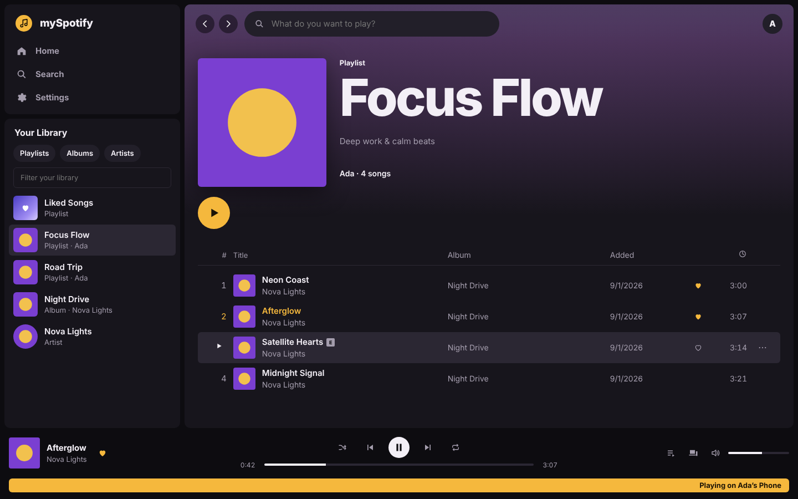

# mySpotify

A fast, keyboard-friendly music player for your Spotify account. It runs on your own computer as a
single `mySpotify.exe` (or from source with plain Python) and plays through Spotify's official Web Playback SDK.



**You need:** Spotify Premium, Windows 10/11 (or macOS/Linux), and Edge, Chrome, or Firefox.

## Run it on Windows (no Python needed)

### 1. Download mySpotify.exe

Go to [**Releases**](https://github.com/vosbek/my-spotify/releases/latest) and download `mySpotify.exe`.

The exe isn't code-signed, so the first time you open it Windows may show **"Windows protected your PC"**.
Click **More info**, then **Run anyway**. Each release also lists the file's SHA-256 checksum, so you can
check the download (`Get-FileHash .\mySpotify.exe` in PowerShell).

### 2. Create your Spotify app (one time, about 5 minutes)

Spotify requires every app to have its own Client ID. It is free.

1. Go to <https://developer.spotify.com/dashboard> and sign in with the Spotify account you listen with.
2. Click **Create app**. Any name and description work (Spotify's terms don't allow "Spotify" in the
   app's name, so call it something like "My Player").
3. Under **Redirect URIs**, add exactly: `http://127.0.0.1:8888/callback`
4. Under **Which API/SDKs are you planning to use?**, tick **Web API** and **Web Playback SDK**.
5. Save. Open the app's **Settings** and copy the **Client ID** (32 letters and numbers).
   You do **not** need the Client secret.

### 3. Start mySpotify

Double-click **`mySpotify.exe`**. A small window opens, and so does your browser at
<http://127.0.0.1:8888>. Paste the Client ID, click **Sign in with Spotify**, and approve.
Keep the small window open while you listen; close it to stop mySpotify.

### Prefer to run from source?

Install Python (`winget install Python.Python.3.13`), download this repository (green **Code** button,
then **Download ZIP**, or `git clone https://github.com/vosbek/my-spotify`), and double-click **`start.cmd`**
or run `py myspotify.py`.

### 4. Make it feel like a desktop app (optional)

In Edge, open the `...` menu, then **Apps > Install this site as an app**. In Chrome, open the `⋮` menu,
then **Cast, save, and share > Install page as app**. mySpotify then gets its own window, taskbar icon,
and Start menu entry. Media keys work in both.

## macOS and Linux

```sh
git clone https://github.com/vosbek/my-spotify && cd my-spotify
./start.sh            # or: python3 myspotify.py
```

## Using it

- **Play** a song by double-clicking it, pressing Enter on it, or hovering and clicking ▶.
- **Devices**: the screen icon in the player bar lists every Spotify Connect device. mySpotify shows up
  as "mySpotify" in Spotify on your phone too, so you can hand music back and forth.
- **Keyboard**: Space play/pause · Ctrl+→/← next/previous · Shift+→/← seek 10s · Ctrl+↑/↓ volume ·
  `/` search · Ctrl+S shuffle · Ctrl+R repeat.
- **Theme**: Settings, then System, Light, or Dark.

## Sharing with friends

Spotify keeps new apps in development mode, which allows **up to 5 people**. Add each person's
Spotify email under **User Management** in your app's dashboard. Each needs Premium to play music.
Anyone can also run their own copy with their own Client ID by following the steps above.

## Troubleshooting

| What you see | What to do |
|---|---|
| `INVALID_CLIENT: Invalid redirect URI` | The Redirect URI in your Spotify app must be exactly `http://127.0.0.1:8888/callback` (not `localhost`). |
| "Spotify refused access" after sign-in | Add your Spotify account's email under **User Management** in the dashboard. |
| "Playing in mySpotify needs Spotify Premium" | Free accounts can browse and control other devices but cannot play in the browser. |
| "This browser cannot play Spotify audio" | Use Edge, Chrome, or Firefox. In Firefox, allow DRM content when asked. |
| Port 8888 is busy | In PowerShell run `.\mySpotify.exe --port 8889` (or `py myspotify.py --port 8889`), then add `http://127.0.0.1:8889/callback` in the dashboard. |
| "Windows protected your PC" | The exe isn't code-signed. Click **More info**, then **Run anyway**. |
| Antivirus quarantines the exe | Single-file Python apps are sometimes flagged by mistake. Compare the SHA-256 with the release page, allow the file, or run from source instead. |
| Player never connects | Try `.\mySpotify.exe --relaxed-csp` (or `py myspotify.py --relaxed-csp`) to rule out the security policy, and disable ad blockers for 127.0.0.1. |

## Privacy and security

- The server listens only on `127.0.0.1` and refuses requests addressed to any other host name.
- Sign-in uses OAuth with PKCE. There is no client secret. Your refresh token stays in this browser's
  storage; **Sign out** in Settings removes it.
- The app talks only to Spotify (`api.spotify.com`, `accounts.spotify.com`, and the SDK and image CDNs),
  enforced by a Content-Security-Policy. All Spotify text is inserted as plain text, never as HTML.
- [`recon/myspotify-self`](recon/myspotify-self/index.html) is a Clearbox security report on this code.

## How it was made

We examined Spotify's Windows installer with [Clearbox](https://github.com/vosbek/reverse-enginer-rea)
(static analysis only) and mapped the desktop app's visible features to Spotify's public API. The notes,
reports, and feature map are in [`recon/`](recon/README.md).

## Project layout

```
myspotify.py        local server (Python standard library only); also the entry point of mySpotify.exe
start.cmd/start.sh  launchers
app/                the app: index.html, styles.css, js/{auth,api,player,ui,main}.js
tests/              server tests (python -m unittest) and a mocked browser smoke test (node tests/ui-smoke.cjs)
recon/              reverse-engineering notes and Clearbox reports
packaging/          icon and Windows version resource for the exe
```

## Building the exe

`.github/workflows/windows-exe.yml` builds `mySpotify.exe` with PyInstaller on a Windows runner, runs the
tests, starts the exe and checks it serves the app, then publishes it as the GitHub Release
`v<VERSION>` (from `myspotify.py`) on every push to `main`. Bump `VERSION` for a new release. To build it yourself on Windows:

```powershell
py -m pip install pyinstaller==6.11.1 pillow==11.0.0
py packaging\make_icon.py
pyinstaller --onefile --name mySpotify --icon packaging\mySpotify.ico --version-file packaging\version_info.txt --add-data "app;app" myspotify.py
```

## Development

```sh
python3 -m unittest discover -s tests
python3 myspotify.py --no-browser --port 8890 &   # then, with Playwright installed:
node tests/ui-smoke.cjs screenshots
```

mySpotify is not affiliated with or endorsed by Spotify. Spotify is a trademark of Spotify AB.
